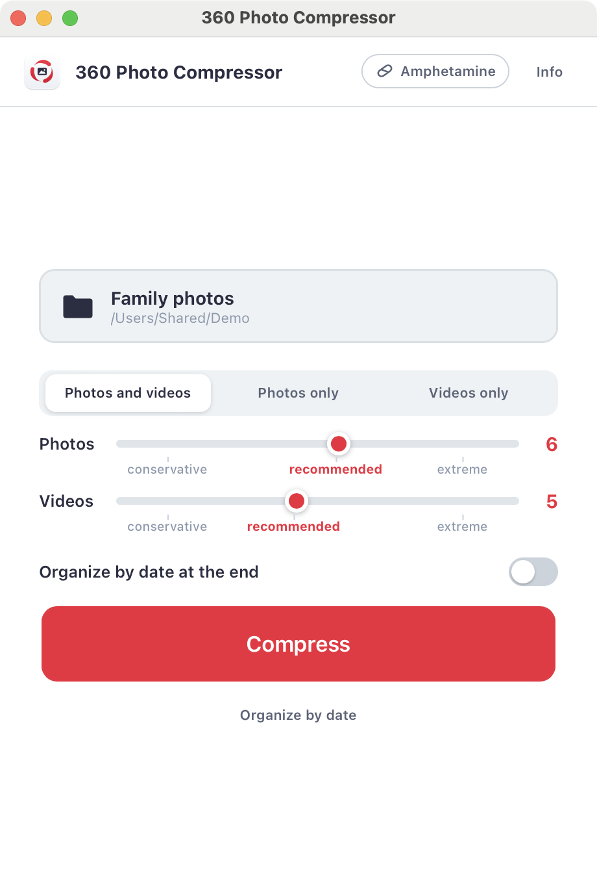
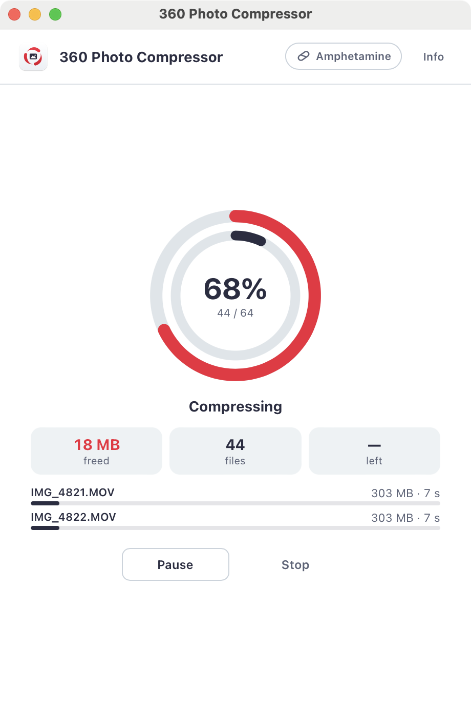
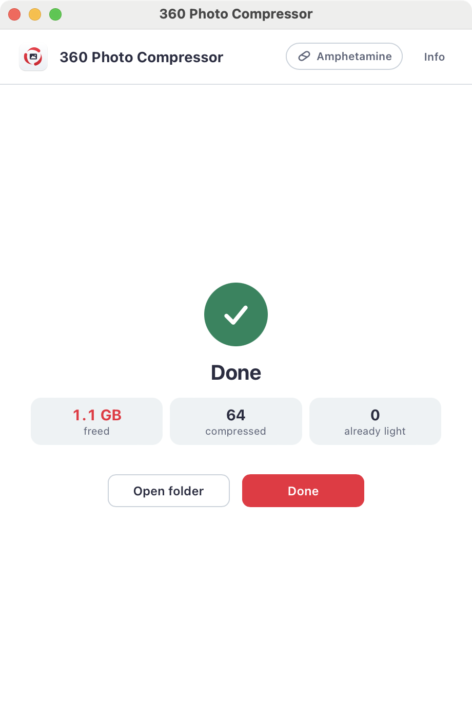
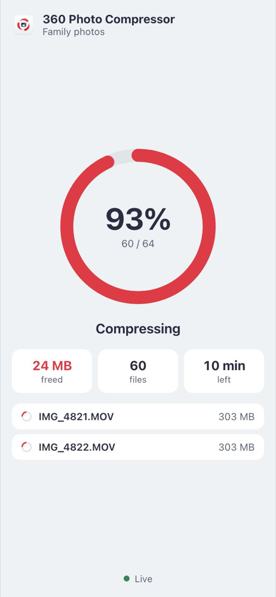

  

<h1 align="center">360 Photo Compressor</h1>

  <b>Your photo library keeps growing. Your disk doesn't. Shrink it without losing a single memory.</b>

  <a href="https://github.com/Mission-F/360-photo-compressor/releases/latest/download/360-Photo-Compressor.dmg"><b>Download for Mac</b></a>
   Free &nbsp;·&nbsp; macOS 12 or later &nbsp;·&nbsp; Intel and Apple Silicon &nbsp;·&nbsp; about 1 MB

  

---

Remember when Google Photos let you keep everything, forever, as long as you were happy with "high quality"? Most people never noticed the difference. Their disks did.

Years of phone backups, exports and copies of copies later, a photo library can easily fill a whole drive. Most of that space goes to quality nobody can see.

**360 Photo Compressor brings that idea back, on your own Mac and your own disks.** Pick a folder or drag it onto the window, press one button, and every photo and video is replaced by a lighter version that looks the same on any screen.

## Lighter, not worse

- **Photos** become JPEG (HEIC included), resized to a sensible maximum. Date, place, orientation and colour profile stay exactly as they were.
- **Videos** are re-encoded in HEVC with your Mac's own hardware. Sound, recording date and HDR colours are kept.
- **You choose how much**: one slider for photos and one for videos, from 1 to 10, with three marks to guide you: conservative, recommended and extreme.
- **Photos only or videos only**, if you want to do one thing at a time.
- **Files that are already light are left alone.** Nothing is ever compressed twice.

## The original goes only when the copy is proven good

Replacing your memories is not something to do lightly, so the program doesn't trust itself:

1. It writes the compressed version to a temporary file.
2. It **reopens that file and checks it**: it must open, have the right size, and for videos the same length and the same sound.
3. Only then is the original deleted and the new file takes its name and its date.

Every step is written down. If the power goes out, the disk disconnects or you quit halfway, the next launch finishes or rolls back whatever was in progress. Nothing is left half done.

  
  

## And then, some order

Years of exports usually end up in folders called `Backup 2`, `Photos from 2019 (1)` or `Takeout 7`. Turn on **Organize by date** and every photo and video moves into a folder for its year and month, based on when it was taken: the camera data, the video metadata, Google Takeout `.json` files or the date in the file name.

Files with no date go into their own folder. Identical copies are set aside so you can check them. Nothing is deleted, and **one button puts everything back** where it was.

Turn on **Break up subfolders** and nothing of the old structure is left: files with no date and other files also go straight into their own folder, so the main folder only contains the years and a couple of clearly named folders.

## Made for long jobs

- **Always see what you have gained**: a big counter shows how much space the job has freed in total, even across pauses, stops and restarts.
- **Pause and resume**: quit the app and it picks up exactly where it stopped, even days later.
- **Works in the background**, with progress always visible in the menu bar.
- **Follow it from your phone**: scan the QR code shown by the app and watch the progress on your phone, over your home Wi-Fi. It is view only, and the private link changes every time you turn it on.
- **Amphetamine mode** keeps your Mac awake, and the screen on if you want, for a set time or until the job is done.
- Works great with network drives and NAS folders.

  

## Free. Really.

No account. No subscription. No ads. No data leaving your Mac: everything happens locally, using only what macOS already includes. The optional phone view stays on your own network.

The interface follows your system: Italian if your Mac is in Italian, English otherwise.

## Installation

1. [Download the DMG](https://github.com/Mission-F/360-photo-compressor/releases/latest/download/360-Photo-Compressor.dmg) and open it.
2. Drag **360 Photo Compressor** onto the **Applications** folder.
3. The first time you open it, macOS will block it. See below: it takes less than a minute, and you only do it once.

### If macOS says it can't be opened or may contain malware

Don't worry: that message appears because the program doesn't have Apple's paid signature, not because a virus was found. Only continue if you downloaded it from this page or from [360msystem.it](https://360msystem.it).

**macOS 14 or earlier.** In Applications, hold **Control**, click the program's icon, choose **Open**, then confirm with **Open**.

**macOS 15 or later** (Control-click no longer works):

1. Try to open the program and close the message.
2. Go to **System Settings > Privacy & Security**.
3. Scroll down to **Security** and click **Open Anyway**.
4. Confirm with your Mac password.

The same instructions are in the `Leggimi - Read me.txt` file inside the DMG. If your photos are on a network drive, macOS will also ask once for permission to access it.

## Before you start

- **Compression replaces your originals.** That is the whole point, and it cannot be undone. If a photo really matters to you, keep a backup somewhere else.
- Try it first on a copy of a small folder, and pick the level you like.
- Videos in old formats such as AVI, MKV or WMV are left as they are.
- Close the lid and your Mac will still go to sleep, unless it is plugged in and connected to a display.

## Where things stand

We would rather tell you exactly how things are. The same approach has already compressed and organized a real library of tens of thousands of photos and videos on an Intel Mac. This version rewrites the engine with only the tools built into macOS: it passed our automated tests, including sudden interruptions during compression, organizing and undo, with no file lost or compressed twice. The Apple Silicon build is included, but so far it has only been run on Intel.

## License

This program is **free but not open source**: you can download it and use it freely, including for work, under the terms in the [LICENSE](LICENSE) file. It is provided as is, without warranty.

© 2026 360 Management System. All rights reserved. For any request: supporto@360msystem.it

Apple, Mac and macOS are trademarks of Apple Inc. Google Photos is a trademark of Google LLC. This project is not affiliated with or endorsed by these companies.
